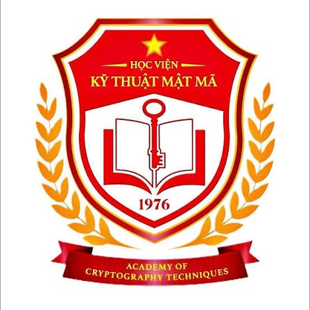

# 🎓 KMA Student OS — Personal Academic Dashboard

<p align="center">
  
</p>

<p align="center">
  <b>Hệ điều hành học tập & quản lý GPA, Thời khóa biểu, Lịch thi và Tiến độ tốt nghiệp dành cho sinh viên Học viện Kỹ thuật Mật mã (KMA).</b>
</p>

<p align="center">
  
  
  
  
  
  
</p>

---

## 🌟 Giới thiệu (Overview)

**KMA Student OS** được phát triển nhằm mang đến cho sinh viên KMA một trải nghiệm học tập hiện đại, trực quan và tiện lợi nhất. Thay vì phải thường xuyên truy cập nhiều cổng thông tin riêng biệt với giao diện truyền thống, KMA Student OS hợp nhất toàn bộ dữ liệu học tập quan trọng vào một giao diện cá nhân hóa duy nhất:

- **Cổng Khảo thí (`khaothi.actvn.edu.vn`)**: Đồng bộ bảng điểm, tính GPA hệ 4 & hệ 10, dự báo mục tiêu học tập.
- **Cổng Quản lý Đào tạo (`qldt.actvn.edu.vn`)**: Đồng bộ thời khóa biểu, phòng học, giảng viên và khung chương trình đào tạo tốt nghiệp.

---

## ✨ Tính năng nổi bật (Key Features)

### 1. 📊 Quản lý GPA & Bảng điểm Toàn khóa
- Đồng bộ bảng điểm chính thức thông qua xác thực **Microsoft SSO (@actvn.edu.vn)**.
- Tự động quy đổi điểm số chính xác giữa **Thang điểm 10** và **Thang điểm 4 (A+, A, B+, B, C+, C, D+, D, F)**.
- Tính toán GPA tích lũy, GPA từng kỳ và xếp loại học lực chuẩn quy chế đào tạo.
- Công cụ **Lập kế hoạch GPA & Mục tiêu học tập**: Giả lập điểm số các môn đang học để tính số điểm cần đạt nhằm đạt học bổng, loại Giỏi hoặc Xuất sắc.

### 2. 📅 Thời khóa biểu & Lịch học Thông minh
- Tự động lấy toàn bộ lịch học từ Cổng QLĐT KMA.
- Chế độ xem linh hoạt: **Xem theo Tháng (Calendar Grid)**, **Xem theo Tuần** và **Xem theo Ngày**.
- Hiển thị đầy đủ thông tin: Phòng học, Giảng viên, Tiết học, Ca học và số tín chỉ.
- Tự động đồng bộ các môn đang học vào danh sách môn của Bảng điểm GPA.

### 3. 🎯 Tiến độ Tốt nghiệp theo Khung Đào tạo Động
- Bóc tách tự động bảng khung chương trình đào tạo (`CourseByFieldTree.aspx`) theo đúng Ngành và Khóa học của từng sinh viên.
- Phân loại rõ ràng từng khối kiến thức:
  - *Khối kiến thức chung*
  - *Khối kiến thức cơ sở ngành*
  - *Khối kiến thức chuyên ngành & Tự chọn*
  - *Khóa luận tốt nghiệp / Thực tập tốt nghiệp*
- Đánh dấu trực quan các môn **Đã hoàn thành (Màu xanh)** và các môn **Chưa học/Chưa đạt**.
- Tính tổng số tín chỉ tích lũy thực tế và số tín chỉ còn thiếu để ra trường.

### 4. 📝 Quản lý Công việc & Lịch thi (Tasks & Exams)
- **Công việc**: Quản lý deadline bài tập, đồ án, bài thuyết trình theo từng môn học.
- **Lịch thi**: Theo dõi lịch thi giữa kỳ, cuối kỳ, phòng thi, số báo danh và đếm ngược ngày thi.

### 5. 🎨 Giao diện KMA Crimson Red & Slate/Obsidian
- Thiết kế cao cấp theo phong cách Modern Academic Dashboard (lấy cảm hứng từ Linear, Notion, Apple).
- Bộ màu nhận diện **Đỏ KMA (`#E11D48`)** kết hợp nền tối **Deep Obsidian (`#0B0C0E`)** sắc sảo.
- Hỗ trợ đầy đủ chế độ Sáng/Tối (Light/Dark Mode).
- Tối ưu hóa phản hồi 100% cho màn hình máy tính (Desktop), máy tính bảng (Tablet) và điện thoại di động (Mobile).

### 6. 🔒 Bảo mật & Quyền riêng tư
- **100% Client-Side Storage**: Dữ liệu bảng điểm, thời khóa biểu và ghi chú cá nhân được lưu trữ trực tiếp trong bộ nhớ trình duyệt (`LocalStorage`) của người dùng.
- Không lưu trữ mật khẩu hay tài khoản của sinh viên trên bất kỳ máy chủ trung gian nào.

---

## 🛠️ Công nghệ sử dụng (Tech Stack)

### Frontend (`artifacts/gpa-dashboard`):
- **Framework**: [React 19](https://react.dev/) + [TypeScript](https://www.typescriptlang.org/)
- **Build Tool**: [Vite](https://vitejs.dev/)
- **Routing**: [Wouter](https://github.com/molefrog/wouter)
- **State Management & Caching**: [TanStack Query v5](https://tanstack.com/query/latest) + Global React Context
- **Styling**: [Tailwind CSS v4](https://tailwindcss.com/) + CSS Variables
- **UI Components**: Radix UI + Lucide Icons + Recharts

### Backend Proxy Server (`artifacts/api-server`):
- **Runtime**: [Node.js](https://nodejs.org/)
- **Server**: [Fastify](https://fastify.dev/)
- **Scraping & HTML Parsing**: [Cheerio](https://cheerio.js.org/) + [Axios](https://axios-http.com/)
- **Build**: [ESBuild](https://esbuild.github.io/)

---

## 🚀 Hướng dẫn Cài đặt & Chạy cục bộ (Local Setup)

### Yêu cầu môi trường:
- [Node.js](https://nodejs.org/) phiên bản 18 trở lên
- Trình quản lý gói `npm` hoặc `pnpm` / `yarn`

### 1. Clone mã nguồn về máy:
```bash
git clone https://github.com/Phamminhhaik7/KMAStudentOS.git
cd KMAStudentOS
```

### 2. Cài đặt dependencies:
```bash
# Cài đặt cho Backend Server
cd artifacts/api-server
npm install

# Cài đặt cho Frontend Dashboard
cd ../gpa-dashboard
npm install
```

### 3. Khởi chạy ứng dụng:
Mở 2 cửa sổ terminal riêng biệt:

**Terminal 1 — Chạy Backend Proxy (Port 5000):**
```bash
cd artifacts/api-server
npm run dev
```

**Terminal 2 — Chạy Frontend Dashboard (Port 3000):**
```bash
cd artifacts/gpa-dashboard
npm run dev
```

Truy cập trình duyệt tại địa chỉ: `http://localhost:3000`

---

## 📁 Cấu trúc Thư mục (Project Structure)

```text
KMAStudentOS/
├── artifacts/
│   ├── api-server/              # Backend Proxy API (Port 5000)
│   │   ├── src/
│   │   │   ├── lib/             # Parsers (Curriculum, Timetable, Grades, Microsoft SSO)
│   │   │   ├── routes/          # API endpoints (/api/grades, /api/timetable, /api/curriculum)
│   │   │   └── index.ts         # Fastify server entry
│   │   └── package.json
│   │
│   └── gpa-dashboard/           # Frontend React SPA (Port 3000)
│       ├── public/              # Logo KMA & Icons
│       ├── src/
│       │   ├── components/      # UI components, Layout, Dialogs, Header, Sidebar
│       │   ├── hooks/           # Context Providers (GPA, Timetable, Curriculum, Tasks, Exams)
│       │   ├── pages/           # Các trang (Dashboard, Schedule, GPA, Tasks, Exams, Degree, Settings)
│       │   ├── index.css        # KMA Crimson & Obsidian Design Tokens
│       │   ├── App.tsx          # Main Router & Providers
│       │   └── main.tsx
│       └── package.json
│
└── README.md
```

---

## 👨‍💻 Tác giả & Đóng góp (Author & Community)

- **Tác giả**: SV (Gehihi) — Sinh viên Học viện Kỹ thuật Mật mã (KMA).
- **Email liên hệ**: [CT100127@actvn.edu.vn](mailto:CT100127@actvn.edu.vn)
- **GitHub Repository**: [Phamminhhaik7/KMAStudentOS](https://github.com/Phamminhhaik7/KMAStudentOS)
- **Báo lỗi & Góp ý tính năng**: [Gửi phản hồi tại GitHub Issues](https://github.com/Phamminhhaik7/KMAStudentOS/issues)

---

<p align="center">
  Phát triển với ❤️ dành riêng cho cộng đồng sinh viên Học viện Kỹ thuật Mật mã.
</p>
